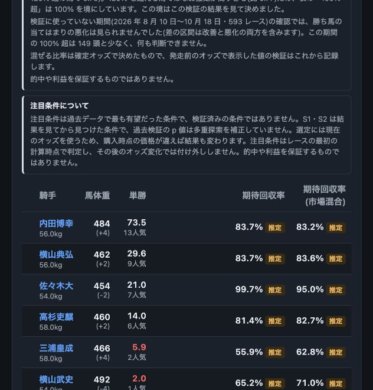
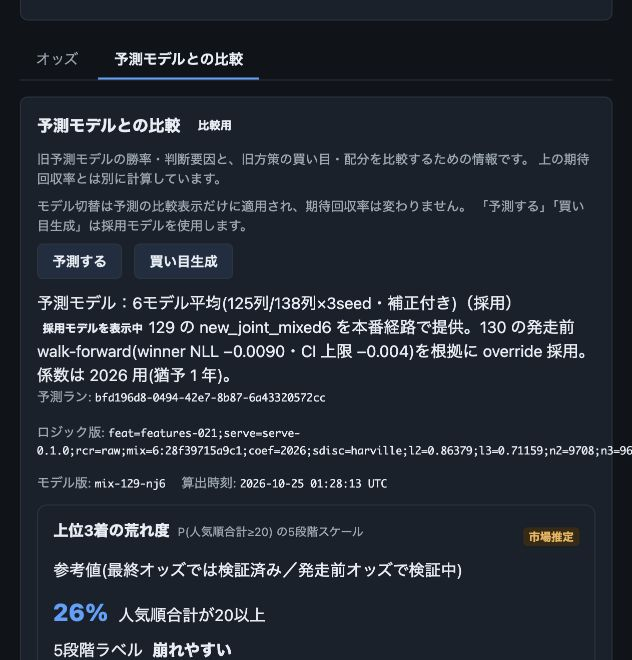

# 154 実装結果

2026-10-26完了。レース詳細の初期表示をROI系の出走表へ整理し、旧予測モデルの買い目推奨を「予測モデルとの比較」へ移した。

## 表示

- 主領域は期待回収率・市場混合・注目条件と馬番順の出走表。「検証中」、推定表示、既存の検証値・不確実性・計算/使用オッズ時刻・取消・内訳を維持。
- 旧モデルの勝率・連対/複勝・市場差・寄与・実行来歴・生成ボタンは比較タブへ移動。初回表示では旧予測/買い目APIを取得しない。
- 比較を一度開いた後はhiddenで保持し、タブ移動中も既存のジョブpollと成功時invalidate、選択モデルを保持。レース変更時は初期化する。
- 旧買い目・Kellyは比較用の仮予算による換算と明示。実際の購入記録・訂正・手入力は「購入記録・訂正」の折りたたみ内に保持。
- モデル切替は予測の比較表示だけで、生成操作は採用モデルを使用する。未生成の非採用モデルから採用モデルへ明示して戻れる。結合確率は選択モデルを引き継ぐ。
- 主表の単勝は現在保存値、ROIは計算時のオッズ基準と区別。ROI使用時刻を現在オッズの取得時刻として転用しない。
- 狭幅では名前を不自然に縦折りせず、表の中を横スクロールする。EV/mixのソート・順位強調を追加していない。

## 保持する境界

API schema・DB・activeモデル・学習/予測/EV/閾値・S1〜S5・opsの生成や自動処理・購入記録のpayloadを変更していない。旧モデルや保存予測/推奨は削除しない。新しいROI由来の買い目や購入操作は追加していない。

## 検証

- `pnpm exec vitest run --maxWorkers=2 --minWorkers=1`: 46ファイル・399テスト成功。
- `pnpm typecheck`、`pnpm lint`、`pnpm build`、`git diff --check`: 成功。
- 初期の旧API未取得、ROI維持、503/404、モデル切替、404復帰、別レース初期化、比較タブ離脱中のjob完了と再取得、Jointモデル一致、馬番順・EV非ソート、仮予算・閉じた記録欄、注目条件の局所的表示規律を検証。
- 既存RaceChaosPanelのページ統合テストも比較を開く新導線へ更新し、予測未生成でも荒れ度が比較内に残ることを維持。
- 既存ローカルAPIの実データ（202605040907、2026-10-25東京7R）をブラウザで確認。ROIの使用オッズ時刻・市場混合・注目条件、比較内のmix-129-nj6・旧買い目・記録折りたたみ、狭幅横スクロールを確認。実データへの生成/記録ボタンは実行していない。
- 独立した静的レビューで残ブロッカーなし。API/DB/ML/ops計算への変更なし、表示系列・ジョブ寿命・復帰・記録機能を確認。独立担当による全テスト再実行ではない。

既存のNode localstorage警告とReact Router future flag警告はテスト出力にあるが、テストはすべて成功。

## 確認画像

